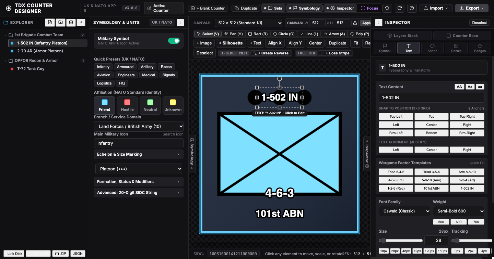
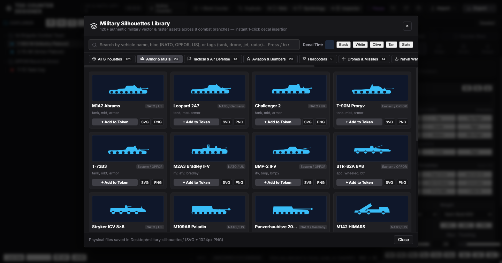
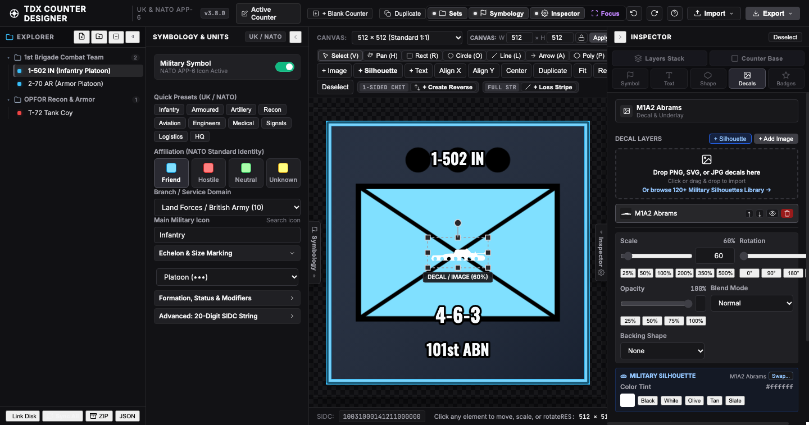

# TDX Counter Designer

**TDX Counter Designer** is a standalone, 100% self-contained military counter, wargaming chit, and NATO tactical symbology design suite.

All **121 authentic military silhouettes**, NATO APP-6D / MIL-STD-2525D symbology catalogs, the milsymbol graphics rendering engine, and vector CAD export tools are bundled directly into a single offline HTML file.

---

## 🚀 Live Demo (GitHub Pages)
👉 **Launch Counter Designer directly in your browser:**  
**[https://cushhcishh.github.io/counter-designer/](https://cushhcishh.github.io/counter-designer/)**

*(Or download [`counter-designer.html`](counter-designer.html) and double-click to run offline on any device with zero server or internet connection required).*

---

## 📸 Screenshots

| Tactical Counter Canvas & Inspector | Built-in 121 Military Silhouettes Library |
| :---: | :---: |
|  |  |

| Custom Wargame Chit with Decal Placement |
| :---: |
|  |

---

## ✨ Features

- **100% Self-Contained Single File**: Zero npm, node, or web server required. Share the single `.html` file via AirDrop, email, Discord, or USB drive.
- **121 Unique Military Silhouettes**:
  - **Armor & AFVs (23)**: M1A2 Abrams, Leopard 2A7+, Challenger 2, T-90M Proryv, T-72B3, T-80BVM, Leclerc XLR, K2 Black Panther, Merkava Mk 4M, BMP-2, BMP-3, M2A3 Bradley, Boxer 8x8, HIMARS, BM-21 Grad, M109 Paladin, etc.
  - **Tactical Air Defense (13)**: Gepard, Tunguska, Pantsir-S1, Patriot PAC-3, S-400 Triumf, Humvee, JLTV, Armed Technical with DShK, HEMTT, Ural-4320.
  - **Combat Aviation (20)**: A-10C Warthog, B-2A Spirit, B-52H, F-15E, F-16C, F-22A, F-35A, Su-27 Flanker, Su-57 Felon, Eurofighter Typhoon, Rafale, C-130 Hercules, C-17.
  - **Rotary Wing (9)**: AH-64 Apache, Mi-24 Hind, CH-47 Chinook, Ka-52 Alligator, UH-60 Black Hawk, Tiger, Viper, Hip.
  - **Drones & Missiles (14)**: MQ-9 Reaper, Bayraktar TB2, Shahed-136, FPV Strike Quadcopter, Tomahawk, ATACMS, Switchblade 600, Lancet-3, Iskander-M.
  - **Naval Combatants & Submarines (12)**: Supercarrier, Queen Elizabeth, Wasp LHD, Arleigh Burke DDG, Type 45, Type 055, Virginia SSN, Ohio SSBN, Akula SSN.
  - **Small Arms & Heavy Weapons (18)**: AK-47, Colt M4A1, SVD Dragunov, Barrett M82 .50 cal, FN SCAR-H, M240B, PKM, M2 Browning .50 on tripod, DShK, RPG-7, FGM-148 Javelin, Stinger, M777 Howitzer.
  - **Field Fortifications & Obstacles (12)**: Reinforced concrete bunker, sandbag MG post, Dragon's Teeth, Czech hedgehog, concertina wire, TM-62 mine, Claymore mine, tactical trenches.
- **NATO APP-6D & MIL-STD-2525D Symbology**: Complete integrated standard symbology generator with echelon pips, unit modifiers, and tactical domains.
- **Wargame Tabletop Die-Cuts**: Sharp square, rounded square, clipped chamfer octagonal, circular pog, hexagon, and shield counters with customizable corner radius and 3D cardboard thickness bevels.
- **Precision Transforms & Snapping**: 8-handle transform gizmo, group rotation stem, multi-layer marquee, direct anchor point editing, and 1-click alignment/distribution.
- **High-Res Export**: Deep Vector SVG and 300+ DPI PNG export matching canvas placement, layer ordering, and tints.

---

## 📄 License
MIT License. Open source and free for tabletop game designers, wargamers, and hobbyists.
